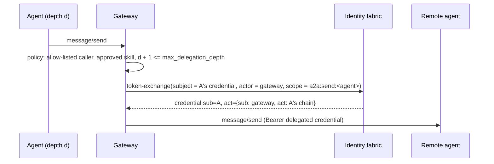

# A2A federation design

## The gateway as an A2A agent

`GET /.well-known/agent-card.json` publishes the gateway's card (A2A 0.3:
`protocolVersion`, `name`, `description`, `url`, `version`, `capabilities`,
`skills`, `securitySchemes`, `security`, `preferredTransport: JSONRPC`,
`supportsAuthenticatedExtendedCard`). The public card lists one skill,
`federated-agent-routing`; the authenticated extended card
(`agent/getAuthenticatedExtendedCard`) adds one skill per approved remote
skill the caller may use, so the federated catalog is never public.

`POST /a2a` accepts JSON-RPC 2.0:

| Method | Behaviour |
|---|---|
| `message/send` | Route to `metadata["mcp-a2a-gateway/target-agent"]` (on the params or the message), optional `metadata["mcp-a2a-gateway/skill"]` |
| `tasks/get`, `tasks/cancel` | Only for tasks the calling agent created through the gateway |
| `agent/getAuthenticatedExtendedCard` | Card with the caller's federated skills |
| `message/stream`, `tasks/resubscribe` | `-32004` UnsupportedOperation |
| `tasks/pushNotificationConfig/*` | `-32003` PushNotificationNotSupported |

Gateway errors use A2A codes where they exist (`-32001` task not found,
`-32006` invalid agent response) and the implementation range for the rest
(`-32040` unauthenticated, `-32041` forbidden, `-32042` approval required,
`-32043` rate limited, `-32044` upstream unavailable).

## Trust domains

Each federated trust domain is configured with:

| Setting | Purpose |
|---|---|
| `card_jwks_url` or `card_jwks` | Keys that may sign that domain's agent cards |
| `card_hosts` | Host globs for card URLs and for the agent endpoint in a card |
| `max_classification` | Ceiling for data that may flow to (and be reached by) the domain |
| `max_delegation_depth` | Longest delegation chain the domain accepts, counting the gateway's hop |
| `token_issuer`, `token_jwks_url`, `token_audience`, `inbound_scopes` | Optional inbound federation: the domain's agents may call this gateway |

## Agent cards

Registration takes a card URL (fetched, size-capped, no redirects) or an
inline card. The card must parse as an A2A card, its endpoint must be HTTPS on
one of the domain's `card_hosts`, and (unless `require_signed_cards` is off)
at least one `signatures` entry must verify: the payload is the card without
`signatures`, canonicalized per RFC 8785; the JWS is detached (RFC 7515
Appendix F); the key is looked up by `kid` in the domain's JWKS only (`jku` and
`x5u` are ignored, so a card can never nominate its own key). Accepted
algorithms: EdDSA, ES256, RS256. `python -m mcp_a2a_gateway.cardsign` signs
cards for publication.

The verified card is pinned by digest and follows the same lifecycle as tools.
`refresh` re-fetches and re-verifies; a different digest becomes a new draft
version and the reviewed version keeps serving. Messages always go to the
pinned card's URL.

## Delegated authority per hop

- The scope is the single caller scope covering `a2a:send:<card id>`; the
  fabric additionally intersects it with the gateway's own registration.
- A federated (inbound) caller cannot be routed onward: the fabric cannot
  vouch for a foreign subject, and transitive federation would let a partner
  reach a third party under our name.
- The approval requirement, classification ceiling and caller allow list are
  evaluated by the same policy engine as MCP calls.

## Inbound federation

A token whose `iss` matches a federated domain's `token_issuer` is verified
against that domain's JWKS and audience, its `sub` must be a SPIFFE ID in that
domain, and its scopes are intersected with `inbound_scopes` (scopes that are
broader than the ceiling are dropped, not narrowed). Federated callers are
decided by gateway policy only, capped at the domain's classification ceiling,
and need approval for destructive tools.

## Task ownership

`message/send` results of kind `task` are recorded as `task id → (card id,
calling agent)`. `tasks/get`, `tasks/cancel` and messages continuing a task
(`message.taskId`) are allowed only for the same agent and card; anything else
gets `-32001` as if the task did not exist.

## Response inspection

Text parts and string leaves of data parts anywhere in the returned Task or
Message (status message, artifacts, history) are inspected as EXTERNAL
content. Injection indicators or credentials replace the result with `-32006`;
PII is redacted when the card policy asks for it. Identifiers and protocol
fields are never rewritten.
