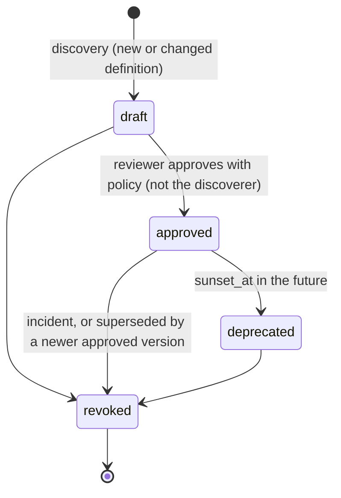

# MCP gateway design

## Surface

Agents connect to one MCP server at `POST /mcp`, implemented with the official
SDK's `MCPServer` (FastMCP was renamed `MCPServer` in mcp 2.x) on the
Streamable HTTP transport in **stateless JSON mode**. Both protocol eras are
served: the `initialize` handshake (2025-11-25 and earlier) and the
per-request envelope with `server/discover` (2026-07-28). Stateless mode means
no session affinity; any replica serves any request (ADR-0002).

| Tool | Source | Notes |
|---|---|---|
| `<server>__<tool>` | Upstream, pinned version | Only approved/deprecated versions the caller is entitled to; `_meta` carries `mcp-a2a-gateway/version` and `mcp-a2a-gateway/definition-hash` |
| `gateway__approval_status` | Gateway | Status of an approval the calling agent requested (others' approvals are invisible) |
| `gateway__federated_agents` | Gateway | A2A agents the caller may message through `/a2a`, with their approved skills |

Authentication happens before the SDK sees the request. A missing or invalid
credential gets `401` with `WWW-Authenticate: Bearer error="invalid_token",
resource_metadata="<public>/.well-known/oauth-protected-resource"` (RFC 9728,
as the MCP authorization specification requires). The authenticated principal
reaches tool handlers through SDK middleware (`PrincipalBinding`).

## Registry and pinning

A definition is `{name, title, description, input_schema, output_schema,
annotations}`; its SHA-256 over canonical JSON is the pin. Discovery never
changes what agents see. Its report classifies each upstream tool as `new`,
`changed` (a new draft version; a `tool.definition_drift` audit event if the
previous version was serving), `unchanged`, `removed` (still pinned, will fail
the drift check) or `rejected` (invalid name, namespaced name over 64
characters, case-insensitive duplicate, input/output schema not a valid
Draft 2020-12 object schema).

Tool poisoning: description and schema text are scored with agentic-core's
`PromptInjectionDetector`. A version scoring 0.5 or more cannot be approved
without `override_findings_reason` (20+ characters, recorded in the audit
trail).

## Call pipeline

| Step | Control | Failure |
|---|---|---|
| 1 | Per-agent token bucket | `rate_limited` |
| 2 | Resolve the servable pinned version; callers without a covering scope learn nothing (same error as an unknown tool) | JSON-RPC `-32602` |
| 3 | Server enabled | `forbidden` |
| 4 | Arguments ≤ `max_argument_bytes`, valid against the pinned input schema with format checking; violations report paths and keywords, never values | `invalid_request` |
| 5 | Egress DLP: credential material in arguments | `content_blocked` |
| 6 | Approval presented in `_meta["mcp-a2a-gateway/approval-id"]` verified against caller, chain, target and payload digest | `forbidden` / `approval_required` |
| 7 | Gateway policy + identity fabric `/v1/authorize`; most restrictive wins | `forbidden` or `approval_required` with `approval_id` |
| 8 | Delegated credential: RFC 8693 exchange, scope = the caller's scope covering `mcp:<server>:<tool>` | `forbidden` |
| 9 | Live definition digest equals the pin (cached per server for `definition_ttl_seconds`) | `tool_definition_changed` |
| 10 | Upstream call with the SDK `Client`, byte ceiling on the wire, timeout, circuit breaker | `upstream_*`, `response_too_large` |
| 11 | Output inspection over model-visible text only (text blocks, embedded text resources, resource-link labels, structured content): injection indicators or credentials block; PII redacted when the policy asks | `content_blocked` |
| 12 | Structured output validated against the pinned output schema | `content_blocked` |
| 13 | Signed audit event: actor, chain, version, definition hash, argument and response digests, size, redactions, both policy digests | audit failure fails the call |

Gateway errors are returned as tool results with `isError: true` and a JSON
body (`error`, `error_description`, plus `approval_id`/`expires_at` when an
approval is pending), so the model can react; unknown tools are protocol
errors (`-32602`).

## Upstream credentials

| `auth.mode` | Presented upstream | Use |
|---|---|---|
| `delegated` (default) | RFC 8693 token from the fabric: `sub` = calling agent, `act.sub` = gateway, one scope | Upstreams that authorize per agent |
| `static_bearer` | Secret from `GATEWAY_UPSTREAM_SECRET_*` (mounted from the secret manager) | Upstreams with a service credential only |
| `none` | Nothing | Upstreams protected by network policy or mesh mTLS |

The agent's own credential is never forwarded (MCP forbids token passthrough).

## Upstream protocol client

Each operation opens a short-lived SDK `Client` (`mode="auto"`: discover,
falling back to the handshake) over an `httpx2` transport wrapped by
`LimitedTransport`, which rejects a declared `Content-Length` over the limit
and aborts the stream as soon as the counted bytes cross it, before anything
is parsed. No upstream session is shared between agents. Upstream JSON-RPC
error text is untrusted and is not relayed; only the code is.
