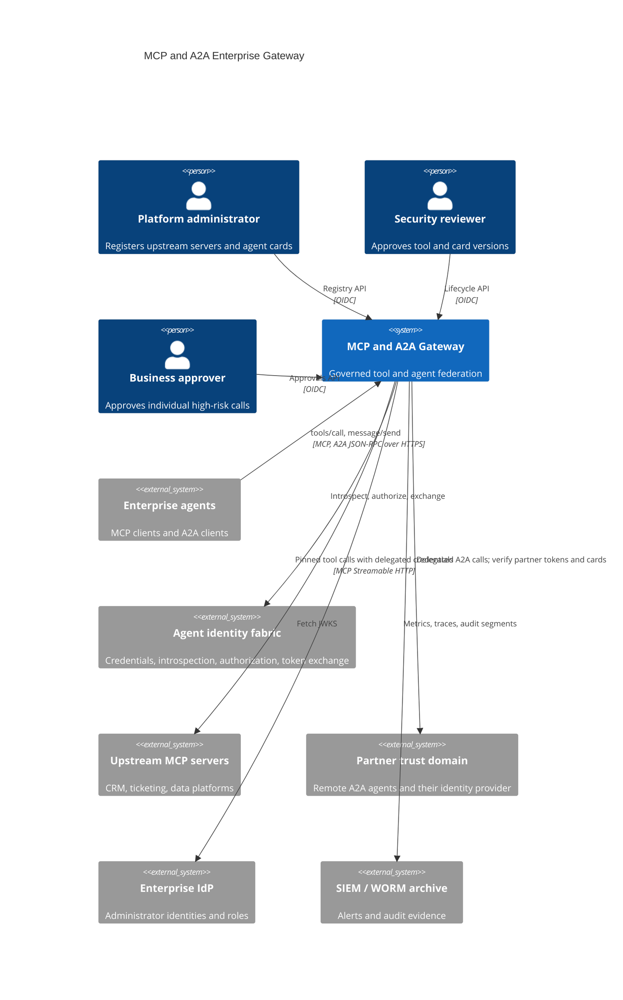
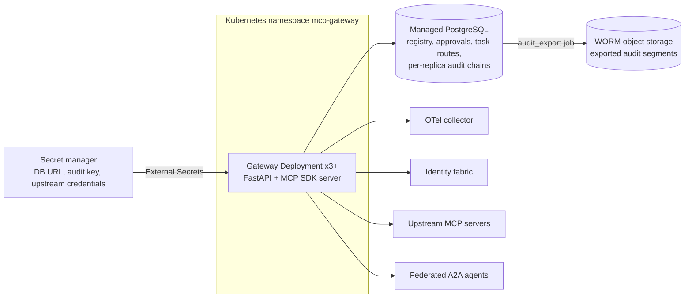
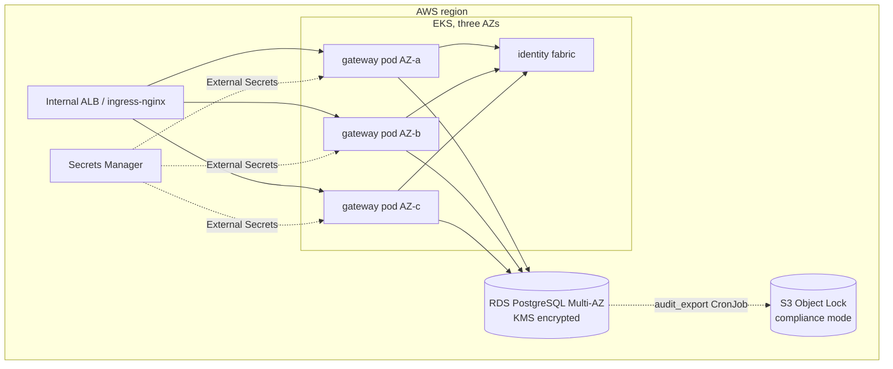

# Architecture

## Business problem

Enterprises adopting agents end up with dozens of MCP servers (CRM, ticketing,
data platforms, internal APIs) and a growing number of agents that call each
other, some of them operated by partners. Without a gateway every agent
connects to every server directly: tool definitions change without review,
credentials are copied into agent configuration, a malicious or compromised
server can rewrite a tool description to steer the model, tool output flows
straight into prompts, and nobody can answer "which agent called what, on
whose behalf, under which policy" after the fact. Cross-organization agent
calls make it worse: there is no shared notion of who the caller is or how far
delegated authority may travel.

The gateway is the one place where those controls are enforced, uniformly,
for every MCP tool and every A2A agent.

## System context (C4 level 1)



## Containers (C4 level 2)



## Components (C4 level 3)

| Layer | Module | Responsibility |
|---|---|---|
| API | `api.mcp_endpoint` | SDK `MCPServer` subclass: per-agent catalog, tool dispatch, gateway tools; HTTP authentication gate with RFC 9728 challenge |
| API | `api.a2a_endpoint` | Agent Card, JSON-RPC dispatch, A2A error codes |
| API | `api.routes`, `api.app` | Admin REST API (OIDC roles), operations endpoints, correlation IDs, metrics, error bodies |
| Application | `application.registry.ToolRegistry` | Server registration, discovery, definition pinning, lifecycle, separation of duties |
| Application | `application.mcp_gateway.McpGateway` | The governed call pipeline; live definition drift checks |
| Application | `application.directory.AgentDirectory` | Card registration, signature verification, pinning, refresh, lifecycle |
| Application | `application.federation.A2AFederation` | Routing, skill rules, task ownership, delegation depth, response inspection |
| Application | `application.authorization.Authorizer` | Gateway policy + fabric decision, most restrictive wins |
| Application | `application.approvals.ApprovalService` | Payload-bound, single-use, expiring human approvals |
| Application | `application.credentials.UpstreamCredentials` | Which credential to present upstream; RFC 8693 exchange |
| Security | `security.authn`, `jwks`, `admin` | Agent authentication (fabric, local JWKS, federation), admin OIDC |
| Security | `security.card_signatures`, `inspection`, `egress`, `resilience` | JWS card verification, ContentGuard inspection, egress allow list, rate limits and circuit breakers |
| Integrations | `integrations.identity_fabric`, `mcp_upstream`, `a2a_client` | Wire clients with byte limits and fail-closed error mapping |
| Infrastructure | `infrastructure.database` | SQLAlchemy Core repositories and the SQL audit sink |
| Runtime | `runtime.container` | Composition root |

## Sequences

### Onboarding an upstream MCP server

```mermaid
sequenceDiagram
  participant A as Admin (alice)
  participant R as Reviewer (bob)
  participant G as Gateway
  participant U as Upstream MCP server
  A->>G: POST /v1/servers (url on egress allow list)
  A->>G: POST /v1/servers/crm/discover
  G->>U: tools/list (gateway's own credential)
  G->>G: validate names and schemas, hash each definition, score text for injection
  G-->>A: report: new / changed / removed / rejected (drafts, audited)
  R->>G: POST /v1/tools/crm/lookup_customer/versions/1/approve (policy)
  G->>G: reviewer != discoverer; flagged text needs override; supersede older version
  G-->>R: approved, pinned hash recorded (audited)
```

### Governed tool call

```mermaid
sequenceDiagram
  participant Ag as Agent
  participant G as Gateway
  participant F as Identity fabric
  participant U as Upstream
  Ag->>G: POST /mcp tools/call crm__create_ticket (Bearer agent credential)
  G->>F: introspect (active? revoked? epoch? chain)
  G->>G: rate limit, pinned version, schema + size check, egress DLP
  G->>G: gateway policy (allow list, lifecycle, risk, delegation)
  G->>F: /v1/authorize
  alt require_approval and no approval presented
    G-->>Ag: isError approval_required + approval_id
    Note over Ag,G: approver decides via /v1/approvals; agent repeats with _meta approval id
  end
  G->>U: tools/list (cached) - live hash == pinned hash?
  G->>F: token exchange: subject=agent, actor=gateway, scope=mcp:crm:*
  G->>U: tools/call with delegated credential, byte ceiling, circuit breaker
  G->>G: inspect output (injection, credentials, PII), validate output schema
  G-->>Ag: result (audited with digests, decisions and policy digests)
```

### Federated A2A message

```mermaid
sequenceDiagram
  participant Ag as Local agent
  participant G as Gateway
  participant F as Identity fabric
  participant P as Partner agent
  Ag->>G: POST /a2a message/send metadata.target-agent=partner-research
  G->>F: introspect + authorize a2a:send:partner-research
  G->>G: card servable? caller allow-listed? skill approved? depth+1 <= partner limit?
  G->>F: token exchange (subject=agent, actor=gateway)
  G->>P: message/send to the pinned card URL with delegated credential
  P-->>G: Task
  G->>G: inspect text and data parts; remember task owner
  G-->>Ag: Task (later tasks/get only for the same agent)
```

## Deployment view (AWS reference)



Azure (AKS, PostgreSQL Flexible Server zone-redundant, Key Vault, immutable
blob storage) and GCP (GKE, Cloud SQL regional, Secret Manager, retention-locked
GCS) are provisioned by the sibling Terraform roots with the same shape.

## Data

| Store | Data | Classification | Retention |
|---|---|---|---|
| `upstream_servers`, `tool_versions` | Registrations, pinned definitions, policies, reviewers | INTERNAL | Life of the server + 7 years |
| `agent_cards` | Verified, pinned cards and policies | INTERNAL | Life of the federation + 7 years |
| `approvals` | Requester, chain, target, payload digest, redacted preview, decision | CONFIDENTIAL | 7 years |
| `task_routes` | Remote task id → agent card, owning agent | INTERNAL | 90 days |
| `audit_events` | Signed hash-chained events per replica (digests, not payloads) | CONFIDENTIAL | Exported to WORM (7 years); purge from the database only after export |

Agent credentials, delegated credentials, tool arguments and tool output are
never persisted or logged; audit events carry SHA-256 digests.

## CI/CD

`ci.yml`: quality on Python 3.12 and 3.13 (ruff, black, mypy strict, bandit,
contract drift, the full test pyramid with a 90% branch-coverage gate),
PostgreSQL integration (repository tests plus the service and security
scenarios on PostgreSQL), deployment artifacts (Helm lint/render and the
required-values check, kubeconform, Terraform fmt/validate for three clouds,
Trivy config scan), container (build, smoke test, Trivy image scan, Syft SBOM,
Grype gate) and Semgrep. `release.yml` on a `v*` tag re-runs the quality gate,
checks the version, pushes the image with provenance attestation and SBOM,
publishes the Helm chart to GHCR OCI and creates the GitHub release.

## Acceptance criteria

| # | Criterion | Evidence |
|---|---|---|
| AC1 | A tool is callable only after a reviewer other than its discoverer approves it | `tests/unit/test_registry.py::test_separation_of_duties_on_approval` |
| AC2 | A changed upstream definition never reaches an agent without re-approval | `test_rug_pull_blocks_calls_until_review`, `tests/security::test_t2_rug_pull_is_blocked` |
| AC3 | Upstreams never receive an agent's own credential | `tests/security::test_t1_agent_token_is_never_passed_through` |
| AC4 | High-risk calls execute only with a matching, unused, unexpired human approval | `test_high_risk_tool_requires_single_use_human_approval`, `test_t10_*` |
| AC5 | Injected or credential-bearing output never reaches the agent | `test_injected_tool_output_is_blocked`, `test_t4_*`, `test_injected_remote_response_is_blocked` |
| AC6 | Unsigned, tampered or out-of-domain agent cards are refused | `TestDirectory`, `test_t7_*`, `test_t8_*` |
| AC7 | Delegated authority is bounded per hop and never re-delegated from a partner | `test_caller_allow_list_and_delegation_depth`, `test_t11_*` |
| AC8 | Every call outcome is in a verifiable signed audit chain; audit failure fails the call | `test_lifecycle_endpoints_and_audit`, `tests/chaos::test_audit_failure_blocks_the_call` |
| AC9 | Works with the real identity fabric, including suspension taking effect immediately | `tests/e2e/test_identity_fabric_interop.py` |
| AC10 | Interoperates with the official MCP SDK client in both protocol eras | `tests/e2e/test_http_lifecycle.py::test_both_protocol_eras_are_served` |
